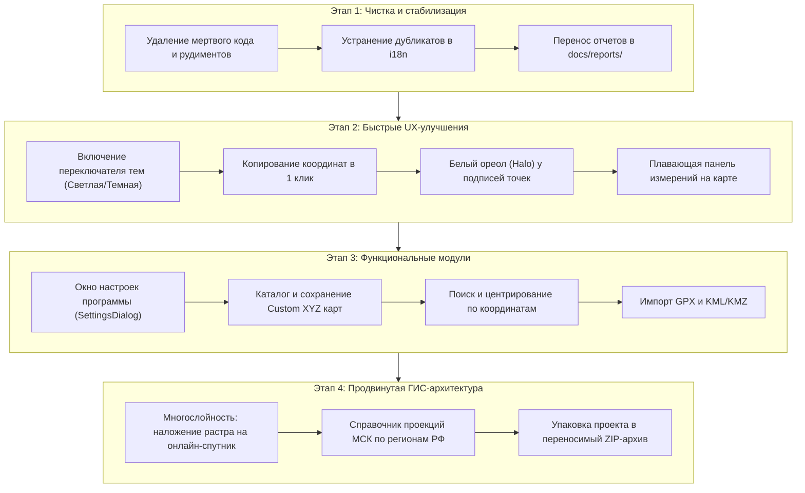

# Комплексный план развития, очистки и улучшений GeoPoint Mapper (RME-Mapper)
**Дата формирования:** 11 ноября 2026 г.  
**Версия приложения:** 1.0.1  
**Назначение документа:** Сводный список рекомендаций по удалению рудиментов и мёртвого кода, закрытию функциональных пробелов и внедрению удобств (UX / Quality of Life).

---

## 1. Что удалить и убрать (Технический долг и рудименты)

Удаление этих элементов снизит объём неиспользуемого кода, устранит скрытые ошибки и сделает кодовую базу чистой.

### 1.1. Мёртвые методы и заглушки в коде
- [ ] **`MainWindow._add_layer_checkbox` (`src/rme_mapper/ui/main_window.py:1745`)**  
  Пустой метод-заглушка (`pass`), оставшийся от старой архитектуры до выноса логики в `layers_panel.py`. Нигде не вызывается.
- [ ] **`OnlineTileManager.render_tiles_to_painter` (`src/rme_mapper/maps/online_tile_manager.py:377–417`)**  
  40 строк неиспользуемого кода. Отрисовка тайлов при экспорте карты перенесена напрямую в `map_renderer.py`.
- [ ] **`OpenMapDialog.build_profile` (`src/rme_mapper/ui/open_map_dialog.py:797`)**  
  Неиспользуемый метод, имеющий побочный эффект в виде закрытия диалога (`self._on_accept_clicked()`).
- [ ] **Вызов `ws.close()` в `object_export_service.py:386`**  
  У объекта `openpyxl.worksheet.worksheet.Worksheet` нет метода `close()` (метод есть только у `Workbook`). Вызов гарантированно бросает `AttributeError` и маскируется пустым `except: pass`.

### 1.2. Очистка словарей локализации (i18n)
- [ ] **Устранить 7 конфликтующих дубликатов ключей** в `translations_ru.py` и `translations_en.py`:
  - `points.count_total` (строка 112: `"Точек: {count}"` vs строка 810: `"Всего: {count}"`)
  - `points.count_filtered` (строка 113 vs строка 809)
  - `menu.point_labels_content` (строка 667 vs строка 757)
  - `label_content.name`, `label_content.number`, `label_content.number_name` (строки 668–670 vs 758–760)
  - `action.change_category` (строка 675 vs строка 775)
- [ ] **Удалить неиспользуемый ключ `points.counter_filtered` (`translations_ru.py:808`)**.

### 1.3. Организация файлов в корне репозитория
- [ ] Перенести **9 файлов старых отчётов** (`TEST_REPORT_STAGE20...27.md`, `smoke_success.txt`) из корня репозитория в каталог `docs/reports/` или `docs/history/`. Корень проекта должен содержать только конфигурационные файлы сборки (`pyproject.toml`, `requirements*.txt`), файл документации `README.md` и исполняемые сборочные скрипты.

---

## 2. Чего критически не хватает и что нужно добавить (Функциональные пробелы)

### 2.1. Полноценное окно настроек программы (Preferences / Settings)
- **Проблема:** В `AppSettingsService` уже заложена богатая конфигурация (размер дискового кэша тайлов, язык по умолчанию, радиусы охранных зон, стили точек, форматы отображения координат, последние каталоги), но **в приложении вообще нет окна настроек**.
- **Что добавить:** Диалоговое окно `SettingsDialog` (вызов через `Правка -> Настройки...` или шестерёнку в тулбаре):
  - Вкладка **«Общие»**: выбор языка интерфейса, темы оформления, автосохранение снимков восстановления.
  - Вкладка **«Карта и кэш»**: максимальный размер кэша онлайн-тайлов (МБ), кнопка очистки кэша, сглаживание отрисовки.
  - Вкладка **«Точки и стили по умолчанию»**: дефолтный цвет маркеров, форма (круг, квадрат, треугольник), размер маркера, радиус зоны по умолчанию.
  - Вкладка **«Координаты»**: приоритетный формат отображения (DD или DMS), разделители, число знаков после запятой.

### 2.2. Многослойность (Совмещение онлайн-подложки и локального растра/плана)
- **Проблема:** В текущей архитектуре приложение работает в режиме единого источника карты. Включение онлайн-подложки (OSM/Спутник) принудительно выгружает привязанный растр (PNG/TIFF) или слои GeoPackage.
- **Что добавить:**
  - Возможность наложить геопривязанное изображение (план горных работ, топографический план участка, схему генплана) **поверх спутниковой онлайн-карты**.
  - Ползунок прозрачности (0–100%) для наложенного растра в панели слоёв.
  - Это превратит GeoPoint Mapper в полноценный рабочий инструмент для сверки проектов с актуальной местностью.

### 2.3. Постоянный каталог и сохранение пользовательских онлайн-карт (Custom XYZ / WMS)
- **Проблема:** Пользовательские XYZ-подложки сейчас сбрасываются после перезапуска приложения (`AppSettingsService.save_custom_provider` не задействован).
- **Что добавить:**
  - Сохранение введённых URL-шаблонов XYZ в постоянный список настроек с возможностью давать им имена (например: *«Яндекс Спутник»*, *«Google Satellite»*, *«OpenTopoMap»*, *«Кадастр РФ (ПКК)»*).
  - Встроенный каталог популярных проверенных ссылок на базовые карты.
  - Базовая поддержка протокола WMS (Web Map Service), используемого региональными геопорталами.

### 2.4. Поддержка популярных полевых форматов (Импорт GPX, KML/KMZ)
- **Проблема:** Экспорт в KML уже есть, но **импортировать треки и путевые точки из KML/KMZ и GPX нельзя**.
- **Что добавить:**
  - Поддержка импорта файлов `.gpx` (стандарт навигаторов Garmin и мобильных полевых приложений вроде AlpineQuest/OsmAnd).
  - Поддержка импорта файлов `.kml` и `.kmz` (Google Earth).

### 2.5. Каталог местных систем координат РФ (МСК-xx / СК-42)
- **Проблема:** Большинство геодезических и кадастровых изысканий в России ведутся не в WGS 84, а в местных системах координат по субъектам РФ (МСК-50, МСК-16, МСК-21, МСК-66 и т.д.).
- **Что добавить:**
  - В диалоге выбора CRS и диалоге геопривязки сделать поиск по названию или коду EPSG (на базе базы данных `proj.db`).
  - Раздел «Избранные CRS» или готовые пресеты зон МСК для удобного выбора в один клик без ручного ввода WKT-строк.

---

## 3. Какие удобства (UX / UI Quality of Life) можно добавить

### 3.1. Переключатель тёмной темы в интерфейсе
- **Состояние:** Код стилизации тёмной темы в `src/rme_mapper/ui/theme_manager.py` уже написан и готов к работе.
- **Удобство:** Добавить в меню «Вид» подменю:  
  `Вид -> Тема оформления -> [ Светлая | Тёмная | Системная ]`.  
  Это даст комфорт работы в полевых условиях, при слабом освещении и на ноутбуках.

### 3.2. Поле быстрого поиска и перехода на карте
- **Удобство:** Добавить на панель карты (или прямо в верхний угол холста) компактную строку поиска:
  - Ввод координат (например: `56.123456, 47.123456` или `500120 5999800`) + Enter -> мгновенное плавное центрирование карты.
  - Ввод названия точки (например: `Скважина 12` или `Пикет 45`) -> выбор точки в таблице и центрирование вида на ней.

### 3.3. Копирование координат точки в один клик в разных форматах
- **Удобство:** В контекстное меню точки на карте и в таблице точек добавить подменю «Копировать координаты»:
  - `Копировать как DD (56.123456, 47.123456)`
  - `Копировать как DMS (56°07'24.4"N, 47°07'24.4"E)`
  - `Копировать в метрах CRS (Easting, Northing)`
  - `Открыть место в браузере (Яндекс Карты / Google Maps / OpenStreetMap)`

### 3.4. Drag-and-Drop файлов таблиц (.xlsx, .csv) на холст
- **Удобство:** При перетаскивании Excel или CSV файла прямо на окно карты сразу автоматически открывать Мастер импорта с уже выбранным файлом.

### 3.5. Ореол (Halo) подписей точек для читаемости
- **Удобство:** Добавить тонкий полупрозрачный белый ореол (1.5–2 px) вокруг текста подписей маркеров на карте. На тёмных спутниковых снимках, лесных массивах и цветных планах чёрные и синие подписи часто становятся нечитаемыми; ореол решает эту проблему на 100%.

### 3.6. Плавающая панель инструментов измерений (HUD на карте)
- **Удобство:** Разместить в верхнем правом или левом углу карты полупрозрачную плашку с быстрыми кнопками:
  - 📏 Измерить расстояние
  - 📐 Измерить площадь полигона
  - ❌ Очистить измерения
  - 💾 Сохранить результат измерения как постоянный объект/линию проекта

### 3.7. Индикатор численного масштаба
- **Удобство:** Рядом с масштабной линейкой в левом верхнем углу выводить численный картографический масштаб: `1:5 000`, `1:10 000`, `1:25 000`, динамически обновляющийся при зумировании колесиком мыши.

### 3.8. Функция «Упаковать проект в архив» (Portable Project Bundle)
- **Удобство:** Кнопка «Экспорт проекта в ZIP-архив»: собирает файл проекта `.gpmap`, фоновые изображения растров, файлы привязок `.pgw`/`.prj` и слои GeoPackage в один архив. Это гарантирует, что при передаче коллеге на другой компьютер проект откроется со всеми подложками без потери путей к файлам.

---

## 4. Рекомендуемый поэтапный план реализации (Roadmap)

---

## Итог
Реализация предложенных шагов превратит **GeoPoint Mapper** из специализированной утилиты привязки в эргономичное, чистое и функциональное настольное ГИС-приложение профессионального уровня.

